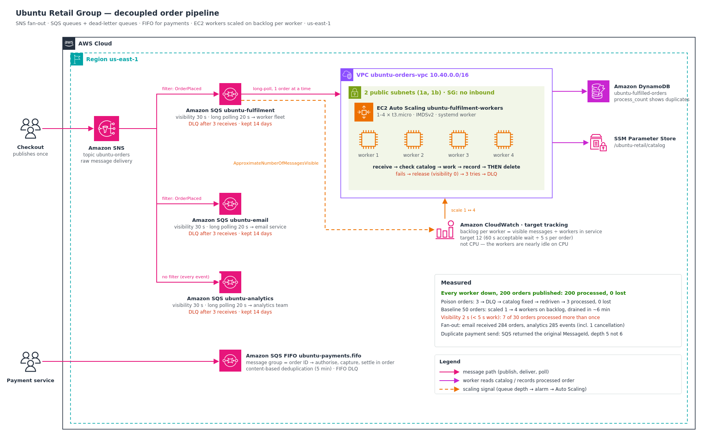

# Decoupled Order Pipeline: SNS fan-out, SQS, dead-letter queues and backlog-scaled workers

Ubuntu Retail Group lost **1,200 online orders** last Black Friday. The website called the order service directly and waited for an answer. When the order service fell over at 09:40, every checkout that reached it for the next 38 minutes failed. There was nowhere for an order to wait. The same failure hit the warehouse, the confirmation emails and the sales dashboard at once, because all three were wired to that one service.

I rebuilt the order path so an order is safe the moment the customer clicks "Pay", whatever is happening downstream. Then I recreated the Black Friday failure on purpose, with every worker down while 200 orders arrived.

**Headline results:**

- **Every fulfilment worker down, 200 orders published: 200 processed, 0 lost.** The orders waited in the queue. When the fleet came back, it scaled itself from 1 to 4 workers on backlog and drained the queue.
- **One publish, three independent copies.** The email and analytics queues received every order (284 and 285 messages), including the ones published during the fulfilment outage.
- **Poison orders didn't block anything.** Three orders for a product missing from the catalog failed three times each and were parked in a dead-letter queue. I fixed the catalog, redrove them, and all 3 were processed, with 0 lost.
- **The classic misconfiguration, measured.** With the visibility timeout (2 s) shorter than the processing time (5 s), **7 of 30 orders were processed more than once**, two of them three times. At 30 s, the same fleet had 0 duplicates across 254 orders.
- **Payment steps stay in order and never double-post.** In the FIFO queue, a duplicate "authorise" returned the **original MessageId**, and the queue held 5 messages, not 6.
- Built and torn down the same day, for well under US$0.10.



---

## The problem I was solving

> An order must be durable the moment it's placed, whether or not anything downstream is healthy. Each downstream team needs its own copy and must be able to fail independently. Workers must scale with the work waiting, not with CPU. Every failure path (a bad message, a dead worker, a wrong timeout) must be visible and recoverable, and "failed" must never mean "lost".

This is the same Ubuntu Retail platform I assessed in `aws-migration-readiness-assessment` and built as a three-tier app in `saa-three-tier-web-app`. That design scaled the web tier. This project fixes what happens behind the checkout button.

---

## Four ideas the whole build depends on

1. **Receiving a message doesn't remove it. Deleting it does.** A received message is hidden for the *visibility timeout*. If the worker crashes or runs past the timeout, the message reappears for another worker. That's why nothing is lost, and also why a message can be processed twice. I proved both.
2. **Publish once, deliver many.** Checkout publishes to one SNS topic. Each team's SQS queue subscribes, and gets its own durable copy and its own failure domain. A filter policy lets each subscription receive only the events it cares about.
3. **Scale on backlog per worker, not CPU.** These workers spend their time waiting on network calls, so CPU stays flat even with thousands of orders queued. The number that matters is *messages waiting ÷ workers in service*. I track it at a target of 12, which is 60 s of acceptable wait ÷ 5 s per order.
4. **Standard queues deliver at least once. FIFO queues deliver in order, once.** Orders use standard queues for throughput and resilience. Payment steps use a FIFO queue grouped by order ID, so authorise → capture → settle can't reorder or double-post.

---

## Architecture decisions

| Requirement | Decision | Why |
|---|---|---|
| Orders survive a dead order service | **SQS queue** between checkout and fulfilment | Messages are kept for 4 days whatever the consumers are doing |
| Three teams need the same event | **SNS fan-out**, one queue per team | One publish; a slow or broken consumer affects only its own queue |
| Email and fulfilment only want new orders | **Subscription filter policy** on `event_type` | Filtering happens in SNS, not in every consumer |
| A message that can't succeed must not loop forever | **DLQ per queue**, `maxReceiveCount` 3, 14-day retention, **redrive** | Failures are parked, visible and replayable |
| Payment steps in order, exactly once | **FIFO queue**, message group = order ID, content-based dedup | Per-order ordering without serialising every order |
| Scale with the work | **Target tracking on backlog per worker** (metric math) | CPU doesn't reflect queued work for I/O-bound workers |
| Cheap, complete polling | **Long polling** (20 s) on every queue | Fewer empty receives, and no missed messages |
| Workers hold no secrets | **Instance role**: one queue, one table, one parameter | Least privilege, temporary credentials |
| Prove it | Fan-out, FIFO, poison, outage and visibility drills, each **counted in DynamoDB** | Measured, not assumed |

Long-form reasoning is in [`docs/adr/`](docs/adr). The architecture diagram uses the **official AWS Architecture Icons** and is generated from [`docs/diagram/build_architecture.py`](docs/diagram/build_architecture.py). The icon pack isn't committed: AWS licenses it for diagrams, not redistribution. Point `AWS_ICONS_DIR` at your own download to regenerate.

---

## How I measured it

Every worker records each order it processes in DynamoDB with `ADD process_count 1`. [`scripts/count_orders.py`](scripts/count_orders.py) then reports, for each run, the orders processed, **lost** (published but never recorded), **processed more than once** (`process_count` > 1), and how many different workers did the work. The worker deletes a message **only after** that write succeeds, so a crash anywhere in between leaves the order on the queue rather than losing it.

| Run | What it tested | Processed | Lost | Duplicates | Workers |
|---|---|---|---|---|---|
| `FANOUT` | An order published **before any worker existed** | 1 / 1 | **0** | 0 | 1 |
| `BASE` | 50 orders on a healthy pipeline | 50 / 50 | **0** | 0 | 4 |
| `PS6` | Poison orders → DLQ → fix → redrive | 3 / 3 | **0** | 0 | 3 |
| `BF` | **Every worker down while 200 orders arrive** | 200 / 200 | **0** | 0 | 4 |
| `VIS` | Visibility timeout 2 s, below the 5 s processing time | 30 / 30 | 0 | **7** | 3 |

Evidence: [`36`](docs/screenshots/36-step14-all-measurements.png).

---

## What I proved

| Test | Result | Evidence |
|---|---|---|
| Queues, DLQs and redrive policy | ✅ Visibility 30, long poll 20, DLQ after 3 receives | [`01`](docs/screenshots/01-step1-queues-and-dlqs-created.png), [`02`](docs/screenshots/02-step1-queue-list-and-redrive-policy.png) |
| Subscriptions: raw delivery + filters | ✅ Fulfilment/email filtered to `OrderPlaced`; analytics unfiltered | [`03`](docs/screenshots/03-step2-filter-policy-applied.png)–[`06`](docs/screenshots/06-step2-analytics-raw-delivery-no-filter.png) |
| Short vs long polling on an empty queue | ✅ 1.9 s vs 22.1 s (both include ~2 s of CLI start-up) | [`07`](docs/screenshots/07-step3-short-vs-long-polling.png) |
| Visibility timeout | ✅ Same MessageId came back; receive count climbed | [`08`](docs/screenshots/08-step3-visibility-timeout-message-returns.png) |
| FIFO deduplication | ✅ Duplicate send returned the original MessageId; depth 5, not 6 | [`09`](docs/screenshots/09-step4-fifo-duplicate-send-same-message-id.png), [`10`](docs/screenshots/10-step4-fifo-depth-five-not-six.png) |
| FIFO ordering | ✅ `ORD-A` steps 1→2→3 and `ORD-B` steps 1→2, in order | [`11`](docs/screenshots/11-step4-fifo-ordered-per-group.png) |
| Fan-out + filter | ✅ Fulfilment 1, email 1, analytics 2 (placed + cancelled) | [`12`](docs/screenshots/12-step5-fan-out-1-1-2.png) |
| Order waits for workers that don't exist yet | ✅ Processed 11 s after the first worker's service started | [`23`](docs/screenshots/23-step9-first-worker-processes-waiting-order.png), [`24`](docs/screenshots/24-step9-worker-log-session-manager.png) |
| Backlog scaling | ✅ 50 orders: 1 → 4 workers at 4m28s, drained in 6m03s | [`25`](docs/screenshots/25-step10-baseline-50-orders-scale-out.png) |
| Poison message → DLQ → redrive | ✅ 3 parked, catalog fixed, move task `COMPLETED 3`, 3 processed | [`26`](docs/screenshots/26-step11-poison-orders-in-dlq.png)–[`28`](docs/screenshots/28-step11-catalog-fix-redrive-zero-lost.png) |
| **Outage drill** | ✅ Fleet at 0, 200 waiting; recovery scaled to 4; **200 processed, 0 lost** | [`29`](docs/screenshots/29-step12-fleet-at-zero-200-orders-waiting.png)–[`32`](docs/screenshots/32-step12-alarmlow-scale-in.png) |
| **Visibility trap** | ✅ 7 of 30 processed more than once (5 × 2, 2 × 3) | [`33`](docs/screenshots/33-step13-visibility-2s-duplicates.png)–[`35`](docs/screenshots/35-step13-fix-visibility-and-purge.png) |
| Teardown | ✅ Every clean-check query empty | [`37`](docs/screenshots/37-step15-clean-check.png) |

**Build evidence** (the infrastructure behind the tests):

| Component | Evidence |
|---|---|
| Three SNS subscriptions; fulfilment filtered to `OrderPlaced` with raw delivery | [`04`](docs/screenshots/04-step2-three-subscriptions.png), [`05`](docs/screenshots/05-step2-fulfilment-raw-delivery-and-filter.png) |
| DynamoDB table + catalog parameter | [`13`](docs/screenshots/13-step6-table-and-catalog.png) |
| Worker role, instance profile, least-privilege policy (one queue, one table, one parameter) | [`14`](docs/screenshots/14-step7-worker-role-and-profile.png), [`15`](docs/screenshots/15-step7-worker-least-privilege-policy.png) |
| VPC, two public subnets, IGW route; security group with **no inbound rules** | [`16`](docs/screenshots/16-step8-network.png), [`17`](docs/screenshots/17-step8-no-inbound-security-group.png) |
| Launch template, Auto Scaling group, group metrics | [`18`](docs/screenshots/18-step9-launch-template.png), [`19`](docs/screenshots/19-step9-asg-and-metrics-collection.png) |
| Backlog-per-worker policy (metric math) and its two alarms | [`20`](docs/screenshots/20-step9-backlog-policy-part1.png), [`21`](docs/screenshots/21-step9-backlog-policy-part2.png), [`22`](docs/screenshots/22-step9-scaling-alarms-created.png) |

Walkthroughs: [`docs/fan-out-and-filtering.md`](docs/fan-out-and-filtering.md), [`docs/fifo-payments.md`](docs/fifo-payments.md), [`docs/backlog-scaling.md`](docs/backlog-scaling.md) and [`docs/reliability-drills.md`](docs/reliability-drills.md).

---

## The outage drill, minute by minute

| Time (UTC) | Event |
|---|---|
| ~09:32 | Fleet set to **0**. Every worker terminated (`0 0 0`) |
| 09:34:03 | **200 orders published.** Fulfilment queue: 200 waiting, 0 in flight. Email and analytics keep receiving their copies |
| 09:36:35 | Fleet restored to 1 worker |
| 09:40:47 | Backlog per worker ≈ 177 against a target of 12, so the scaling alarm raises desired capacity to **4** |
| 09:41:06 | 4 workers in service; the queue falls ~25 orders a minute |
| ~09:47 | Queue empty (estimated; see below) |
| 10:02:41 | `AlarmLow` fires after 15 low minutes, and the fleet scales back in to 1 |
| — | `count_orders BF 200`: **200 processed, 0 lost, 0 duplicates** |

**About the drain time:** my watcher stopped polling between 09:44:55 (64 orders left) and 10:24:10, while the laptop sat idle. So the "47m54s" it printed isn't the drain time. From the last measured rate (146 → 64 in 3m12s, about 25 orders a minute with 4 workers), the remaining 64 needed roughly 2.5 more minutes, which puts the drain at **about 11 minutes after recovery**. The scale-in alarm cross-checks this: `AlarmLow` needs 15 consecutive low minutes and fired at 10:02:41, so the backlog was low by about 09:47. I'm reporting it as an estimate, not a measurement.

---

## The visibility trap

With the visibility timeout at **2 s** and each order taking **5 s**, a received order reappeared while its first worker was still working on it, and a second (sometimes third) worker picked it up. Result: **7 of 30 orders processed more than once**, `VIS-0025` and `VIS-0029` three times. Nothing errored and nothing was lost. The only symptom was duplicate work, which in a warehouse means two parcels.

I expected some of those orders to spill into the dead-letter queue as well. None did (DLQ 0): with only 3 busy workers, there was rarely an idle one free to push a message past its 3rd receive. I've kept that in the write-up because it's what actually happened.

The fixes, recorded in [ADR 0005](docs/adr/0005-visibility-timeout-sizing-and-idempotent-consumers.md), are to size the visibility timeout above the worst-case processing time (heartbeat it for long jobs), and to make consumers idempotent with a conditional write. My worker uses `ADD` on purpose so duplicates are counted rather than hidden.

---

## Debugging along the way

- **I learned to chain commands into one sequence.** In the visibility demo I ran each command on its own, reading the output before writing the next one. The time I took between them was longer than the 5 s visibility timeout, so the message I expected to be hidden came straight back and the receive count jumped from 1 to 3. SQS was behaving correctly; my timing wasn't. From then on I combined related commands into a single sequence, with the waits built in (for example `receive && receive && sleep 4 && receive`, or scale to zero, `sleep 90`, then check), so timing-dependent steps ran back to back and I saved time on every drill. Every later drill ran exactly as I designed it.
- **Peeking at a DLQ with visibility 0 returns the same message repeatedly.** One receive call returned `PS6-0003` ten times, with its receive count going 4 → 13. It was harmless on a DLQ, but on a queue with a redrive policy that "peek" could itself push a message into the DLQ.
- **The drain watcher went quiet for 39 minutes.** I didn't report the number it printed as the drain time. I derived the real figure from the measured rate and cross-checked it against the scale-in alarm.
- **Cost Explorer showed `-US$0.00` on build day.** That's expected: billing data lags by up to a day (see [Cost](#cost)).

Full story: [`docs/debugging-journey.md`](docs/debugging-journey.md).

---

## Cost

| Item | Usage in this build | Approx. cost |
|---|---|---|
| EC2 t3.micro workers | 1–4 instances for about 1.75 h, roughly 5 instance-hours | ~US$0.05 |
| Public IPv4 on workers | ~5 address-hours at US$0.005/h | ~US$0.03 |
| SQS + SNS | A few thousand requests | Free tier |
| DynamoDB on-demand | ~300 writes, a few scans | < US$0.01 |
| CloudWatch | 2 target-tracking alarms for a few hours; group metrics free | < US$0.01 |
| **Total** | | **well under US$0.10** |

**Why Cost Explorer showed `-US$0.00` on the day** ([`38`](docs/screenshots/38-step15-cost-explorer-same-day.png)): Cost Explorer isn't real-time. AWS processes billing data in batches and refreshes Cost Explorer at least once every 24 hours, so usage from today normally appears tomorrow. The same-day screenshot shows what had been processed so far, not the final figure. I check the next day's view to confirm the cents above; anything unexpected there would point at a leftover resource, which the clean check already rules out. Rates are illustrative us-east-1 list prices at build time. Details: [`docs/cost-model.md`](docs/cost-model.md).

---

## Compliance & frameworks

Buffering every order, isolating each consumer, and proving recovery with drills maps onto controls these frameworks require:

- **NIST SP 800-53 Rev. 5**
  - **CP-4 Contingency Plan Testing**: the outage, poison and visibility drills are exercised recovery tests with measured outcomes.
  - **CP-10 System Recovery and Reconstitution**: DLQ redrive restores failed work after the cause is fixed.
  - **SC-5 Denial-of-Service Protection**: the queue absorbs demand spikes instead of passing them to a failing service.
  - **SI-10 Information Input Validation**: invalid orders (unknown SKU) are rejected and quarantined, not processed.
  - **AC-6 Least Privilege**: the worker role is limited to one queue, one table and one parameter.
  - **SC-7 Boundary Protection**: workers accept no inbound connections.
- **NIST Cybersecurity Framework 2.0**
  - **PR.IR-03**: mechanisms to achieve resilience requirements.
  - **PR.IR-04**: adequate resource capacity to ensure availability, via backlog-driven scaling.
  - **ID.IM-02**: improvements identified from tests and exercises.
- **ISO/IEC 27001:2022 Annex A**
  - **A.8.14 Redundancy of information processing facilities**
  - **A.5.30 ICT readiness for business continuity**
  - **A.8.6 Capacity management**
  - **A.8.16 Monitoring activities**
- **SOC 2 (AICPA Trust Services Criteria)**
  - **PI1 Processing Integrity**: complete and accurate processing, evidenced by the lost/duplicate counts per run.
  - **A1.1–A1.2 Availability**: capacity management and recovery infrastructure.
- **PCI DSS v4.0**, for the payment steps where cardholder-data processes are in scope
  - **Req 7.2**: least-privilege access for system components.
  - **Req 1.3**: inbound traffic to the processing tier restricted.
- **POPIA §19 (South Africa)**: appropriate technical measures to safeguard the integrity of customers' order data.

---

## Repo layout

```
.
├── README.md
├── env.sh.example                  # copy to ~/p16/env.sh; holds saved IDs + the save() helper
├── scripts/
│   ├── kit_aws.py                  # shared helper: runs the AWS CLI and stops loudly on errors
│   ├── create_queue.py             # queue + DLQ + redrive policy (standard or FIFO)
│   ├── allow_sns.py                # queue policy: only the ubuntu-orders topic may send
│   ├── publish_orders.py           # N test orders via SNS PublishBatch (10 per call)
│   ├── depths.py                   # waiting / in-flight for every queue
│   ├── watch_drain.py              # live drain + fleet size view
│   ├── count_orders.py             # the measurement: processed / lost / duplicates per run
│   └── render.py                   # fills @@NAME@@ placeholders; refuses to leave any empty
├── policies/
│   ├── filter-order-placed.json    # SNS subscription filter
│   ├── ec2-trust.json
│   ├── worker-perms.json.tpl       # one queue, one table, one parameter
│   └── queue-policy-from-sns.json.tpl
├── templates/
│   ├── backlog-target-tracking.json    # metric math: visible ÷ in-service, target 12
│   └── launch-template.json.tpl
├── worker/
│   └── userdata.sh.tpl             # the worker program + systemd service
└── docs/
    ├── architecture.png / architecture.svg   # official AWS Architecture Icons
    ├── diagram/                    # build_architecture.py + awsdiag.py helper
    ├── fan-out-and-filtering.md
    ├── fifo-payments.md
    ├── backlog-scaling.md
    ├── reliability-drills.md       # outage, poison and visibility drills in full
    ├── debugging-journey.md
    ├── cost-model.md
    ├── teardown.md
    ├── adr/                        # 6 architecture decision records
    └── screenshots/                # 38 build, drill and teardown screenshots, in order
```

> **No account IDs are committed.** Templates use `@@NAME@@` placeholders filled at run time from values saved in `~/p16/env.sh`. There is no `Deny` statement anywhere in the project, so nothing can lock an administrator out at teardown.

---

## Reproduce it

Everything runs from WSL in `us-east-1`:

1. `mkdir -p ~/p16 && cp -r scripts policies templates worker ~/p16/ && cp env.sh.example ~/p16/env.sh && cd ~/p16 && source env.sh`
2. `python3 scripts/create_queue.py ubuntu-fulfilment 30 FUL` (and the same for `ubuntu-email` / `EMAIL`, `ubuntu-analytics` / `ANALYTICS`), then `source env.sh`.
3. Create the SNS topic, run `allow_sns.py` for each queue, subscribe each queue with `RawMessageDelivery=true`, and add the filter to fulfilment and email.
4. `create_queue.py ubuntu-payments 30 PAY --fifo`; send the payment steps with `--message-group-id`.
5. Create the DynamoDB table `ubuntu-fulfilled-orders` and the SSM parameter `/ubuntu-retail/catalog`.
6. Create the worker role from `worker-perms.json.tpl` (rendered) plus `AmazonSSMManagedInstanceCore`, and an instance profile.
7. Create the VPC with two public subnets in two AZs, a route to an IGW, and a security group with no inbound rules.
8. Render `userdata.sh.tpl` and `launch-template.json.tpl`, then create the launch template and the Auto Scaling group (1–4). Enable `GroupInServiceInstances` and apply `backlog-target-tracking.json`.
9. Run the drills: `publish_orders.py BASE 50`, `PS6 3 --sku SKU-PS6`, outage `BF 200`, visibility `VIS 30`. Measure each with `count_orders.py`.
10. Teardown: [`docs/teardown.md`](docs/teardown.md).

---

## What this connects to

- `aws-migration-readiness-assessment` and `saa-three-tier-web-app`: the same Ubuntu Retail platform. This project decouples the order path that sat behind that web tier.
- `aws-private-connectivity-endpoints`: the production version of this worker network uses private subnets with SQS, DynamoDB and SSM endpoints instead of public IPs.
- `aws-well-architected-remediation`: the same Session Manager approach, with no SSH, keys or inbound ports, used here to read worker logs.
- `aws-cost-optimized-redesign`: the next cost lever for these workers is Spot capacity, a natural fit because a terminated worker loses nothing.
- `aws-terraform-iac-pipeline`: the next step for this build is to express it as Terraform modules behind the same plan-on-PR pipeline.
